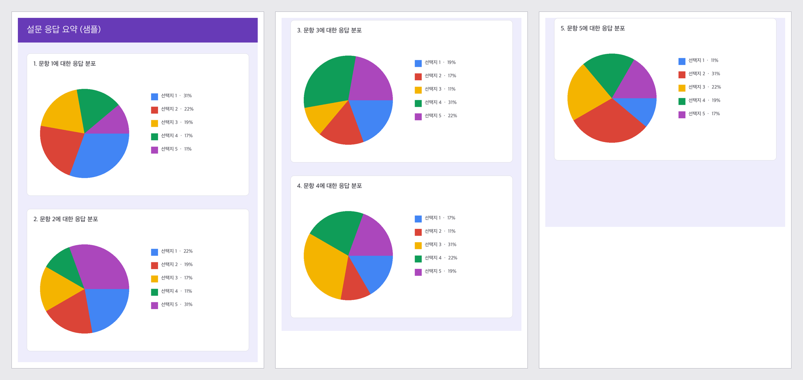

# PrintImg

세로로 긴 이미지(주로 긴 화면 캡처)를 A4 여러 장으로 나눠 PDF로 만들거나 바로 인쇄합니다. 페이지 경계는 되도록 차트나 카드 중간이 아니라 빈 줄에서 자릅니다.

Made by [Isaac](https://www.codeslog.com) · MIT License

**English:** PrintImg splits a tall image (typically a long screenshot) into A4 pages and saves a PDF or prints it directly. It fits the image to the printable width, cuts between pages at blank rows where possible so charts and cards are less likely to be split, and can strip or fade a detected background color. Everything runs locally; nothing is uploaded. Three flavors share the same splitting and background-detection algorithm; defaults and limits differ slightly (see the table below): a single-file browser version (`printImg.html`, no install), a Windows executable, and a macOS app. Built by [Isaac](https://www.codeslog.com).



## 바로 쓰기

설치 없이 쓰려면 HTML 버전, 자주 쓰면 앱 버전이 편합니다.

- **브라우저 (설치 없음)**: **https://isaaceryn.github.io/printImg/printImg.html** 을 열면 바로 씁니다. 오프라인으로 쓰려면 `printImg.html` 한 파일을 내려받아 더블클릭하면 됩니다. 캡처 확장에서 "클립보드로 복사"를 고른 뒤 이 페이지에서 Ctrl+V(맥은 ⌘+V)를 누르면 파일을 저장하지 않고도 바로 넣을 수 있습니다. 이미지를 고르고 미리보기를 확인한 뒤 인쇄(Ctrl+P, 맥은 ⌘+P)합니다. 인쇄 대화상자에서 "PDF로 저장"을 고르면 파일로도 남습니다.
- **Windows**: [Releases](https://github.com/IsaacEryn/printImg/releases)에서 `PrintImg-<버전>-win.exe`를 내려받아 실행합니다. 설치 과정은 없습니다.
- **macOS (Apple Silicon)**: [Releases](https://github.com/IsaacEryn/printImg/releases)에서 `PrintImg-<버전>-mac-arm64.zip`을 내려받아 풀고 `PrintImg.app`을 실행합니다. Intel 맥용 빌드는 아직 없습니다.

처음 실행할 때 뜨는 경고는 개발자 서명을 사지 않아서 그렇습니다. 코드는 이 저장소에 전부 공개되어 있습니다.

- Windows: "Windows의 PC 보호" 창이 뜨면 **추가 정보 → 실행**.
- macOS 15 이상: "열 수 없습니다" 창이 뜨면 닫고 **시스템 설정 → 개인정보 보호 및 보안** 아래쪽의 **"그래도 열기"**를 누른 뒤 로그인 암호를 입력합니다. 이 버튼은 앱을 한 번 열어 본 뒤 약 1시간 동안만 표시됩니다. (직접 빌드한 앱은 이 경고가 뜨지 않습니다.)

## 동작

아래는 Windows·macOS 앱 기준입니다. HTML 버전과의 차이는 다음 절에 있습니다.

- 이미지 폭을 인쇄 가능 영역에 100% 맞춥니다. 작으면 확대, 크면 축소.
- "원본 크기 유지"를 켜면 96 DPI 기준 실제 크기로 출력합니다. 폭이 인쇄 영역보다 넓으면 폭 맞춤으로 자동 전환되므로, 여백 5 mm에서 폭 약 755 px을 넘는 이미지(대부분의 화면 캡처)는 이 옵션을 켜도 폭 맞춤으로 나옵니다.
- 한 페이지를 넘는 높이는 여러 페이지로 나눕니다. 페이지 경계 근처(위쪽 30% 이내)의 빈 줄에서 자르고, 없으면 등분합니다. 끝이 여백뿐인 페이지는 만들지 않습니다.
- "빈 줄에 맞춰 자르기"를 끄면 빈 줄 탐색 없이 등분합니다. 상태줄에 빈 줄에서 잘린 횟수가 표시됩니다.
- "배경색"을 켜면 자동 감지된 배경색(가장자리 최빈색)을 제거(흰색) 또는 흐리게 처리합니다. 색상 버튼으로 직접 고를 수 있습니다. 어두운 배경에 흰 글자인 캡처에는 쓰지 마세요. 배경만 흰색이 되어 글자가 사라집니다.
- 여백은 0~30 mm, 기본 5 mm. 가정용 잉크젯은 아래쪽 인쇄 불가 영역이 넓은 기종(HP DeskJet 계열 약 12.7 mm)이 있으니 잘리면 여백을 키우세요.
- 페이지 수가 50페이지를 넘으면 PDF를 만들지 않고 오류 메시지를 표시합니다.
- 결과 PDF는 원본과 같은 폴더에 `<원본이름>.pdf`로 저장되고 기본 뷰어로 열립니다. 같은 이름이 있으면 덮어쓸지 묻습니다(기본 버튼은 "아니오").
- "바로 인쇄…"는 파일을 만들지 않고 미리보기 창(페이지 썸네일, 프린터 선택)을 연 뒤 선택한 프린터로 보냅니다.

지원 형식: PNG, JPG, BMP, GIF(첫 프레임), WEBP

## HTML 버전

`printImg.html`은 같은 분할·배경 알고리즘을 브라우저에서 돌립니다. 이미지는 브라우저 안에서만 처리되고 어디로도 전송되지 않습니다. 이미지는 파일 선택 외에 클립보드 붙여넣기(Ctrl+V / ⌘+V)와 창에 끌어다 놓기로도 넣을 수 있습니다. 구글 폼 응답 페이지처럼 로그인이 필요한 화면은 전체 페이지 캡처 확장으로 "클립보드에 복사"한 뒤 붙여 넣는 흐름이 가장 짧습니다. 앱과 다른 점:

| | 앱 (Windows·macOS) | HTML |
|---|---|---|
| 결과 | PDF 파일 저장 또는 바로 인쇄 | 브라우저 인쇄 대화상자 (PDF로 저장 가능) |
| 페이지 상한 | 50 | 없음 (대신 렌더링 폭 4096 px 상한) |
| 기본 여백 | 5 mm | 5 mm |
| 원본 크기 유지 | 있음 | 있음 (같은 이름·기본 꺼짐) |
| 배경 "흐리게" | 배경색을 단색으로 연하게 | 픽셀마다 계산 (결과는 거의 같음) |
| 자르는 선 직접 편집 | 없음 | 있음 (옮기기, 추가·빼기, 되돌리기) |
| 구간 빼기·가리기 | 없음 | 있음 |
| 여러 이미지를 한 PDF로 | 없음 (한 번에 한 파일) | 있음 |
| 쪽 번호 인쇄 | 없음 | 있음 (기본 꺼짐) |
| 설정 기억 | 없음 | 여백과 옵션만 (브라우저 저장소) |
| 동작을 확인한 브라우저 | – | Chrome 152 (이 검토에서 실측). Edge는 같은 엔진. Safari는 `@page` 여백·용지 크기를 무시해 머리글·바닥글이 찍힐 수 있습니다 |

인쇄 대화상자에서 여백은 기본값, 배율은 100%로 두세요. 바꾸면 페이지가 어긋납니다.

HTML 버전에서만 되는 편집:

- **자르는 선 옮기기**: 미리보기의 빨간 선을 끌거나 선택한 뒤 방향키로 옮깁니다. 색 경계나 카드가 시작되는 곳에 자석처럼 붙고, Shift를 누른 채 끌면 자석 없이 천천히 움직입니다. "자동" 버튼이나 Delete는 그 선을 자동 위치로 되돌립니다.
- **페이지 나누기 추가·빼기**: 미리보기를 두 번 누르면 그 줄에서 새 장이 시작됩니다. 키보드나 터치로는 각 장의 "＋ 나누기" 버튼을 씁니다. 추가한 선은 "빼기" 버튼이나 Delete로 없앱니다. 뺀 뒤 남은 내용이 한 장을 넘으면 자동 선이 다시 생기고, 자동 선 자체는 뺄 수 없습니다.
- **구간 빼기**: 미리보기 위의 "구간 빼기"를 켜고 위아래로 끌면 사이트 머리글처럼 필요 없는 부분이 인쇄에서 빠지고 페이지가 이어집니다. 패널 3번 목록에서 하나씩 되살릴 수 있습니다.
- **가리기**: "가리기"를 켜고 사각형을 끌면 그곳이 검게 칠해집니다. 구글 폼 응답 캡처의 이름이나 학번을 가릴 때 씁니다. 화면과 인쇄에 쓰는 캔버스 픽셀에 직접 칠하므로 인쇄물과 PDF에는 가려진 원본 픽셀이 남지 않습니다. 원본 이미지 파일은 바뀌지 않습니다.
- **되돌리기**: Ctrl+Z(맥은 ⌘+Z)로 선 이동, 페이지 나누기, 구간, 가리기를 한 동작씩 되돌리고, Ctrl+Shift+Z나 Ctrl+Y(맥은 ⌘+Shift+Z)로 다시 합니다. 기록은 이미지마다 100단계까지이고, 숫자 칸에 입력 중일 때는 그 칸의 입력만 되돌립니다.
- **여러 이미지를 한 PDF로**: 파일을 여러 개 고르거나 끌어다 놓거나 붙여 넣으면 목록 끝에 붙습니다. 목록에서 순서를 바꾸거나 뺄 수 있고, 이미지마다 새 장에서 시작해 목록 순서대로 인쇄됩니다. 선과 구간, 가림은 이미지마다 따로 유지됩니다.
- **쪽 번호 인쇄**: 옵션을 켜면 종이마다 아래쪽에 "n / 전체"를 찍습니다. 여러 이미지는 번호가 이어집니다. 켜도 페이지 나눔은 바뀌지 않고, 끄면 PDF에 글자가 들어가지 않습니다.
- **설정 기억**: 여백과 옵션은 브라우저의 localStorage에 남아 다음 방문에 그대로 적용됩니다. 이미지, 파일 이름, 자르는 선, 구간, 가림은 저장하지 않습니다. 저장이 막힌 환경에서도 앱은 그대로 동작합니다.

## 소스로 실행

Tk가 포함된 Python 3.12 이상이 필요합니다. 가상환경을 쓰세요. 맥의 Homebrew Python은 시스템 site-packages 설치를 막고(PEP 668), `python` 명령 자체가 없을 수 있습니다.

macOS:

```
brew install python-tk@3.13
python3.13 -m venv .venv
.venv/bin/python -m pip install -r requirements.txt
.venv/bin/python src/main.py
```

Windows (python.org 설치본, "tcl/tk" 포함):

```
python -m venv .venv
.venv\Scripts\python -m pip install -r requirements.txt
.venv\Scripts\python src\main.py
```

asdf·pyenv로 설치한 파이썬과 macOS 기본 `python3`(3.9, Tk 8.5)는 대개 Tk가 없거나 너무 오래되어 안 됩니다.

## 테스트

```
.venv/bin/python -m pip install -r requirements-dev.txt
.venv/bin/python -m pytest
```

## 빌드

Windows exe (Windows에서):

```
.venv\Scripts\python -m pip install pyinstaller
scripts\build.bat
```

`build.bat`은 `.venv`가 있으면 그 파이썬을, 없으면 전역 `python`을 씁니다. 결과물 `dist\PrintImg.exe`. 서명이 없어 SmartScreen 경고가 뜹니다.

macOS .app (맥에서만. PyInstaller는 크로스 빌드를 지원하지 않습니다):

```
brew install python-tk@3.13
scripts/build.sh
```

`build.sh`는 Tk가 있는 파이썬을 자동으로 찾아 `.venv`를 만들고 그 안에서 빌드합니다. 다른 파이썬을 쓰려면 `PYTHON=/경로/python3 scripts/build.sh`. 결과물 `dist/PrintImg.app`(onedir 번들, ad-hoc 서명, arm64 전용). 직접 빌드한 앱은 Gatekeeper 경고 없이 열립니다.

배포용 zip은 심볼릭 링크를 유지해야 하므로 `ditto`로 만듭니다:

```
ditto -c -k --keepParent dist/PrintImg.app dist/PrintImg-1.1.0-mac-arm64.zip
```

맥에서는 "바로 인쇄…"가 CUPS(`lpstat`, `lpr`)를 씁니다. 프린터 목록이 비어 있으면 시스템 설정 → 프린터 및 스캐너에서 프린터를 먼저 추가하세요. 실제 프린터 없이 인쇄 경로를 확인하려면 macOS에 들어 있는 가상 IPP 프린터를 쓸 수 있습니다:

```
ippeveprinter -k -d /tmp/printimg-spool -p 8632 -f application/pdf "PrintImgTest" &
lpadmin -p PrintImgTest -E -v ipp://localhost:8632/ipp/print -m everywhere
```

인쇄하면 `/tmp/printimg-spool`에 프린터가 받은 PDF가 그대로 남습니다. 끝나면 `lpadmin -x PrintImgTest`.

## 릴리스 절차

1. 버전을 올린다: `version_info.txt`(4곳), `PrintImg-mac.spec`의 `CFBundleShortVersionString`, `CHANGELOG.md`.
2. Windows exe는 태그를 push하면 GitHub Actions(`.github/workflows/build-windows.yml`)가 빌드해 릴리스에 붙인다. 로컬에서 만들려면 `scripts\build.bat` 후 `dist\PrintImg.exe`를 `PrintImg-<버전>-win.exe`로 이름을 바꾼다. 맥은 `scripts/build.sh` → `ditto`로 zip.
3. `git tag v<버전>` → push. Releases에 `PrintImg-<버전>-mac-arm64.zip`, `printImg.html`을 올리면 Windows exe는 Actions가 채운다.
4. HTML 버전은 GitHub Pages(main, /root)로 https://isaaceryn.github.io/printImg/printImg.html 에 자동 배포된다.

## 알려진 한계

- macOS 앱은 VoiceOver가 Tk 위젯을 읽지 못합니다(Tk 9.0의 한계, Tk 9.1의 접근성 API로 해결 예정). 스크린리더를 쓰면 HTML 버전을 쓰세요.
- 확인창의 버튼이 시스템 언어에 따라 "Yes / No"로 나올 수 있습니다(Tk가 시스템 대화상자를 씀).
- 인쇄 경로별 크기 정책이 다릅니다. Windows는 용지 전체에 100%로 붙이고(여백 0~3 mm면 프린터 인쇄 불가 영역에서 잘림), 맥 CUPS는 프린터의 인쇄 가능 영역에 맞춰 약 3~5% 축소합니다(기종에 따라 다름). 여백을 5 mm 이상으로 두면 둘 다 잘리지 않습니다.
- Letter 용지 프린터는 확인하지 않았습니다. 맥 CUPS 경로는 A4를 강제합니다.

## 맥에서 확인한 것 (2026-09-10, macOS 26.6, Apple Silicon, Python 3.13 + Tk 9.0)

- [x] `pytest` 통과
- [x] `src/main.py`로 창이 뜨고, 이미지 선택 → PDF 만들기 → 덮어쓰기 확인창 → Preview 앱이 열린다
- [x] 배경색 견본에 감지된 색이 보이고, 버튼을 누르면 시스템 색 선택창이 뜬다
- [x] "바로 인쇄…" 미리보기 창의 프린터 목록에 `lpstat -p`의 이름이 보이고, 인쇄하면 가상 프린터에 A4 3페이지 PDF가 도착한다 (임시 PDF는 지워짐)
- [x] `scripts/build.sh`로 만든 `PrintImg.app`이 실행된다
- [ ] 실제 프린터로 종이 출력 (미확인)

## 릴리스 전 수동 확인

- [ ] 샘플 캡처(`docs/img/sample-long.png`)로 3페이지 PDF가 생성되고 뷰어가 자동으로 열린다
- [ ] 페이지 경계가 차트 중간이 아닌 카드 사이 여백에 있다
- [ ] 같은 파일로 다시 만들면 덮어쓰기 확인창이 뜨고 기본 버튼이 "아니오"다
- [ ] (Windows) PDF를 뷰어에서 연 채로 덮어쓰면 "저장할 수 없습니다 (권한 없음)" 메시지가 뜬다. 맥은 열린 파일을 잠그지 않아 그냥 덮어써진다
- [ ] 여백에 범위 밖 값을 넣으면 오류 메시지가 뜬다
- [ ] "원본 크기 유지"로 폭 700 px 이하 이미지를 만들면 가운데 정렬된다
- [ ] "바로 인쇄…"로 미리보기가 뜨고, 프린터를 골라 인쇄하면 실제 종이에 A4 3장이 나온다
- [ ] "배경색" 제거로 회색 배경이 흰색으로 출력된다
- [ ] Python이 없는 PC에서 `PrintImg.exe`가 실행된다

## 만든 사람 · 라이선스

[Isaac](https://www.codeslog.com)이 만들었습니다. MIT 라이선스로 배포하며 전문은 [LICENSE](LICENSE)에 있습니다. 문의나 제안은 https://www.codeslog.com 으로.
